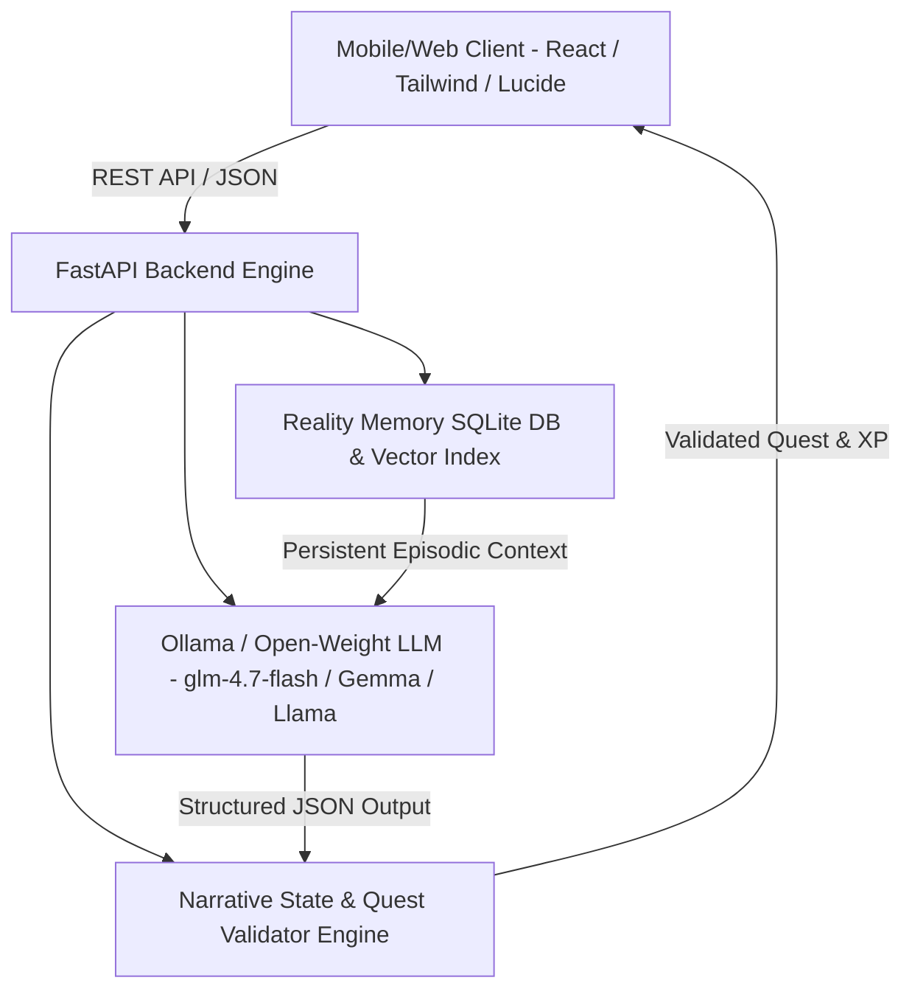

# Product Requirements Document (PRD): Reality Checkpoint

**Project Name**: Reality Checkpoint  
**Tagline**: *Your next level exists outside your screen.*  
**Target Event**: Hacktoberfest 2026 Open-Source AI Challenge — Week 1: "Touch Grass"  
**License**: MIT Open Source  
**Repository Working Directory**: `/home/kali/Hackathons/Hacktoberfest26/Week 1 Challenge`  

---

## 1. Executive Summary & Problem Statement

### 1.1 The Problem
Modern mobile gaming and digital experiences are engineered for continuous screen engagement. Notifications, dopamine loops, and endless feeds compete aggressively for human attention, leading to digital fatigue, sensory numbness, and physical disconnection from physical surroundings. Existing outdoor or fitness gamification apps frequently suffer from two flaws:
1. They require players to stare constantly at their screens (GPS maps, AR overlays, live camera tracking).
2. They turn nature into a surveillance chore (requiring strict geofencing, step counts, or invasive camera validation).

### 1.2 The Solution: Reality Checkpoint
**Reality Checkpoint** is an open-source, AI-driven real-world adventure game that inverts the traditional screen engagement paradigm:
- **The screen is the portal, not the destination.** The player spends 30 seconds setting parameters, receives a bespoke mission, puts the phone away into their pocket or locks it, and physically steps into reality.
- **Dormant Screen Mode:** Once a quest starts, the app enters an offline-friendly, distraction-free dormant mode. No feeds, no ads, no push notifications.
- **Adaptive Open-Weight AI Narrative Loop:** Upon return, the player describes what they experienced. An open-weight model evaluates the reflection, adapts future missions, and weaves the player's personal discoveries into an evolving story.
- **Reality Memory™:** The game maintains a persistent, episodic memory of everything the player has noticed in the physical world (patterns, light shifts, flora, textures, sounds), referencing past observations in future quests like an expanding Field Journal.

---

## 2. Core Game Mechanics & System Pillars

### Pillar A: The Dormant Screen
- **Mechanic**: Once a quest begins, the screen dims into a low-power, ambient state with a subtle breathing pulse and countdown timer.
- **Psychological Effect**: Relieves the anxiety of screen checking. An optional gentle audio chime sounds when the timer completes.
- **Design Rule**: The app explicitly tells the user: *"Put your phone in your pocket. Look up."*

### Pillar B: Reality Memory™ (Signature Mechanic)
- **Mechanic**: Observations made in reflections are parsed into structured memory nodes (e.g., `Category: Flora`, `Detail: Moss between brick paver seams`, `Phenomenon: Shifting solar shadows`).
- **Persistence**: Stored in a local database and vectorized or tagged for semantic retrieval.
- **Evolution**: In future missions, the AI synthesizes past memories into fresh quests:
  - *Day 1*: "You noted a patch of moss growing on the north side of a limestone step."
  - *Day 3*: "Revisit the limestone step or find another shaded surface. Does moisture or shadow pattern differ today?"
  - *Day 7*: The player's Field Journal compiles a personalized environmental dossier.

### Pillar C: Branching Dynamic Storylines
- Quests are not isolated random tasks; they belong to narrative arcs:
  1. *The Architecture of Light & Shadow* (Visual optics, angles, geometry)
  2. *The Acoustic Commons* (Soundscapes, wind refraction, ambient resonances)
  3. *Urban Biomecartography* (Resilience of nature in manufactured environments)
  4. *The Micro-Physics of Daily Life* (Entropy, material textures, wear-and-tear)
  5. *Curiosity & Ephemeral Encounters* (Atmosphere, movement, serendipity)
- Choices and reflection depth directly unlock new story branches.

### Pillar D: Attention Over Surveillance (Anti-Cheat Philosophy)
- We reject GPS tracking, biometric surveillance, and mandatory photo uploads.
- The AI evaluates **depth of attention**, **sensory specificity**, and **perceptual nuance**.
- Socratic follow-up questions verify attentiveness organically without surveillance.
- Safety Guardrails: Hard limits prevent requests to trespass, approach strangers, enter hazardous zones, or cross roads while interacting with the phone.

---

## 3. System Architecture & Tech Stack

### 3.1 Technology Stack
- **Frontend**: Single-Page Responsive Web Application (Vite + React + Tailwind CSS + Lucide Icons + Web Audio API). Optimized for both mobile browsers (PWA-ready) and desktop.
- **Backend API**: Python 3.11+ with FastAPI, Uvicorn, and Pydantic v2.
- **AI Inference**: Local Ollama runtime (`http://localhost:11434`), supporting open-weight models (`glm-4.7-flash`, `gemma2`, `llama3.2`, etc.) with automatic graceful mock/heuristic fallback for zero-dependency environments.
- **Database & Storage**: SQLite3 with WAL mode, structured relational schema (`reality_checkpoint.db`) + JSON episodic memory logs.
- **Validation**: Strict JSON Schema enforcement with Pydantic for deterministic quest generation and reflection grading.

---

## 4. Detailed Component Specifications

### 4.1 Backend Engine (`backend/`)
- `main.py`: FastAPI application entrypoint with CORS, health checks, and API routers.
- `ai_engine.py`: Ollama API client with structured prompts, schema repair, temperature control, and memory injection.
- `models.py`: Pydantic data schemas:
  - `QuestRequest`: time_minutes (5, 10, 15, 30), theme, mood, player_id.
  - `Quest`: id, title, storyline_id, duration_minutes, mission_prompt, sensory_focus, safe_boundaries, follow_up_prompt.
  - `ReflectionInput`: quest_id, player_id, reflection_text, sensory_rating, optional_image_base64.
  - `EvaluationResult`: xp_earned, quality_score, feedback, memory_extracted, unlocked_branch, socratic_question.
  - `RealityMemoryItem`: id, timestamp, quest_id, observation, tags, continuity_anchor.
- `database.py`: SQLite schema management, player progress CRUD, memory store, and storyline progression.
- `safety_guardrails.py`: Rule-based and semantic filter ensuring quests never advise hazardous, illegal, or unsafe actions.

### 4.2 Frontend Application (`frontend/`)
- **Theme**: Obsidian Minimalist / Neo-Solarpunk aesthetics. Dark mode default with forest green (`#2E4742`), warm paper (`#F2F2EB`), and solar amber accents.
- **Views**:
  1. **Checkpoint Portal**: Select time budget, current storyline, view level and recent memories, "Initiate Quest".
  2. **Dormant Quest Screen**: Clean typography, countdown timer, pulsing zen ring, audio chime trigger, "I Have Returned" action.
  3. **Reflection Chamber**: Multi-sensory input field, AI follow-up response, XP reward animation, and branch unlock alert.
  4. **Field Journal & Memory Graph**: Interactive chronicle of player observations, chronological timeline, search/filter by theme.
  5. **Branching Storyline Map**: Visual nodes representing completed missions and available paths.
  6. **System & AI Status**: Real-time status of Ollama connection, model loaded, response latency.

---

## 5. Hacktoberfest Week 1 ("Touch Grass") Compliance

1. **Prompt Alignment**: 100% focused on getting people off screens and into the physical world. Screen time per quest is < 60 seconds; real-world immersion time is 5–30 minutes.
2. **Open-Source AI at Core**: Utilizes open-weight models via Ollama (`glm-4.7-flash` / `gemma` / `llama`).
3. **Privacy by Design**: All memories, reflections, and progression reside on the user's local machine or self-hosted server.
4. **Deliverables**:
   - Complete, tested, deployable codebase.
   - Comprehensive `README.md` with setup steps, license, and architectural breakdown.
   - Official DEV submission post draft in `DEV_POST_DRAFT.md`.
